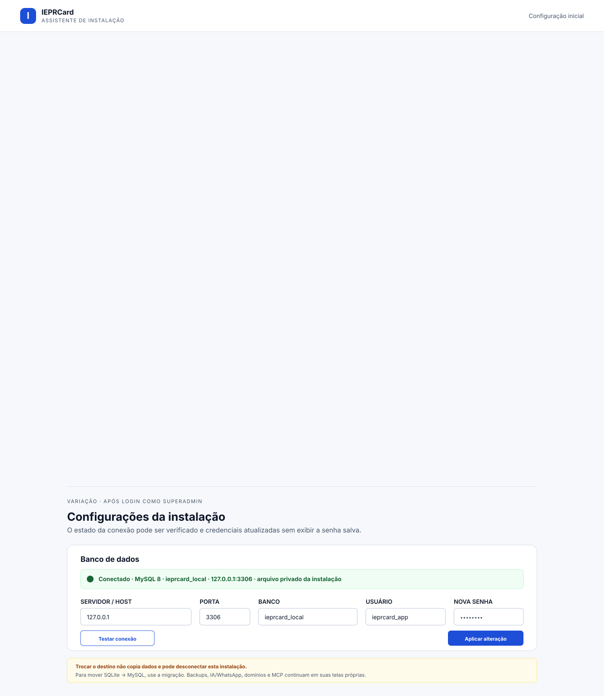

# Página: configuração inicial do banco

Esta etapa resolve a conexão do banco antes do login administrativo. Ela existe porque o bootstrap da aplicação depende de PDO e hoje o `login.php` tenta abrir a conexão antes de renderizar a configuração do primeiro superadmin. O launcher local usa SQLite por padrão; isso explica por que o MySQL já iniciado no Laragon não é selecionado automaticamente.

## Mockup

## Proposta de fluxo

- O instalador pré-login testa host, porta, nome do banco, usuário e senha em uma conexão PDO temporária; não grava dados antes de confirmar que a conexão funciona.
- MySQL/MariaDB é a opção recomendada para Local Host e Hospedado. SQLite permanece disponível apenas para desenvolvimento e testes locais.
- O banco informado já deve existir e estar vazio. O assistente pode criar o schema canônico por migrações versionadas, mas não tenta criar um banco no servidor: hospedagens compartilhadas normalmente provisionam banco e usuário pelo painel do provedor. Um banco ocupado ou incompatível é recusado sem apagar ou alterar seus dados.
- Credenciais de conexão são gravadas atomicamente em configuração privada fora de `public/`, nunca no banco que elas habilitam, na sessão, nos logs ou no repositório. O assistente bloqueia a conclusão quando não encontra armazenamento privado seguro; orienta uso de variáveis de ambiente se o provedor gerencia a configuração.
- Após salvar, a mesma requisição valida novamente a conexão e instala o schema. As próximas etapas criam o superadmin e selecionam Local Host ou Hospedado. Nenhuma delas deve permitir acesso institucional antes do fim da configuração.
- Após instalar, a página global **Administração → Instalação** mostra estado, versão e fonte da conexão. O superadmin pode testar nova senha/credencial sem revelação da atual. Alterar nome do banco ou host não copia nem migra dados; movimento de SQLite para MySQL segue o [guia de migração de banco](../../docs/userguide/migracao-banco.md).
- O assistente de configuração depois do login aponta às telas próprias existentes para domínios, backups/S3, atendimento/IA e MCP. Essas configurações opcionais não bloqueiam a primeira instalação nem duplicam seus formulários.

## Configuração após a instalação

Na variação autenticada da mesma área global, o painel de banco mostra driver, host, porta, nome do schema e fonte da configuração, sem credenciais. **Testar conexão** usa os valores temporários e não os salva. **Aplicar conexão** exige confirmação superadmin, validação do destino e gravação atômica. Credenciais de ambiente que sobrepõem o arquivo privado são indicadas como gerenciadas pelo host; a interface orienta alterá-las no painel do servidor.

A configuração nova não pode transformar falha de conexão em instalação inicial ou habilitar cadastro de outro superadmin. Uma instalação marcada como configurada continua bloqueada até o banco antigo voltar ou o mantenedor executar a recuperação operacional. Trocar conexão não copia dados nem executa migração; o fluxo existente de migração continua sendo a única forma de transferir dados.

## Limites visuais e de acesso

- A etapa pré-login só aparece quando ainda não existe configuração de conexão válida e banco inicializado. Operações de gravação exigem CSRF, rate limit, validação server-side e teste antes de aplicar. A configuração autenticada exige superadmin ativo e reautenticação para salvar credenciais ou trocar de destino.
- URLs do instalador recebem `noindex, nofollow`; mensagens de erro não exibem DSN completo, senha, caminho interno nem stack trace.
- Mostrar apenas o estado e detalhes não secretos da conexão. Campos de senha começam vazios; nunca repovoar a senha salva.
- A UI não oferece execução de SQL arbitrário, edição de schema pelo operador nem sobrescrita de banco com dados. O catálogo e as migrações permanecem sob controle da release.
- Em viewport 1440 px, o formulário usa duas/ três colunas; em 768/375 px, os campos empilham sem rolagem horizontal. Labels persistentes, erros associados e foco visível.

## Referências canônicas

O contrato PDO dual e o banco continuam no [ADR-0002](../../docs/adr/0002-pdo-dual-sqlite-mysql.md). O login do primeiro superadmin permanece no [guia administrativo](../../docs/userguide/admin-login.md); o perfil Local Host/Hospedado permanece no [guia de implantação](../../docs/userguide/admin-deployment-mode.md). Segredos de integrações e sua chave mestra continuam sujeitos ao [ADR-0008](../../docs/adr/0008-webhooks-idempotentes-e-segredos.md).

## Estado

Mockup e guia funcional aprovados pelo mantenedor em 2026-11-25. Implementação rastreada na [Issue #102](https://github.com/agthinkindigital/IEPRCard/issues/102); a tela e os endpoints ainda não existem.
