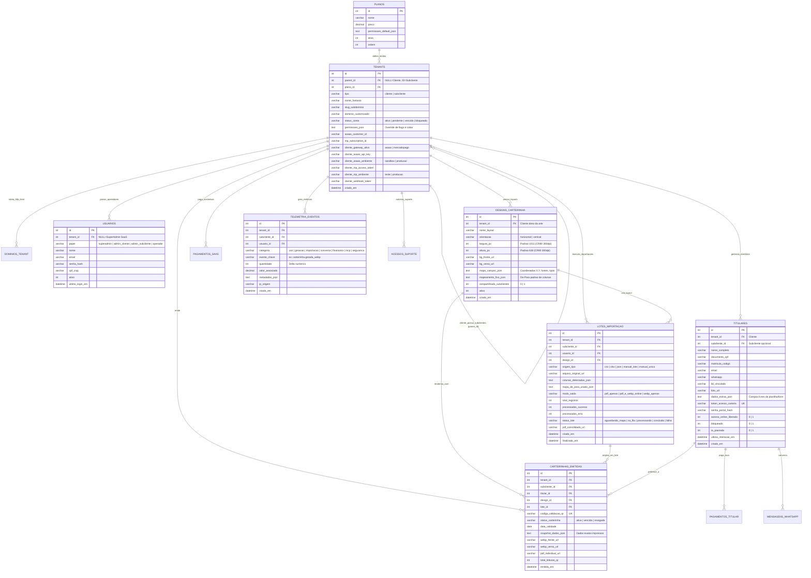
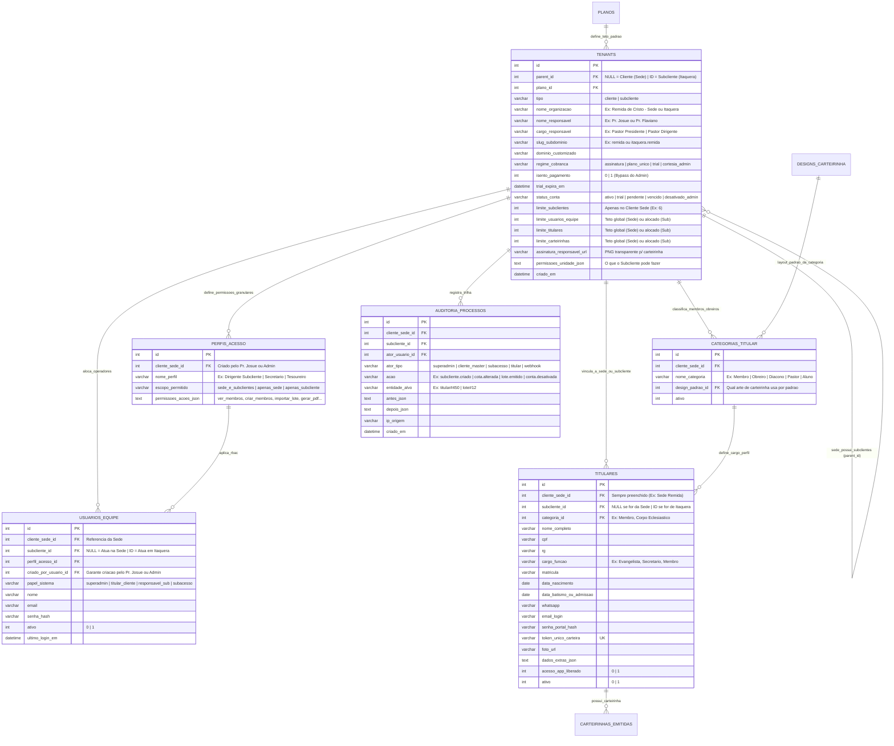

# ERD e Dicionário de Dados

**Escopo:** este arquivo preserva ERDs e referências anteriores. Para o MVP, prevalece o schema canônico de 27 tabelas descrito em `docs/adr/0005-schema-canonico-unificado.md`; tabelas, credenciais e fluxos de pagamento são futuros e não devem ser criados agora. O modelo consolidado de destino fica em `docs/architecture/SAD.md` §4.6.

## 2. ERD (Diagrama Entidade-Relacionamento) e Dicionário de Dados Dual

Para cumprir o requisito de compatibilidade **SQLite $\rightarrow$ MySQL/MariaDB**, o schema abole o tipo `ENUM` nativo do MySQL (usado nos arquivos legados) em favor de `VARCHAR(30)` com validação estrita na camada de domínio PHP, utiliza `TEXT` para estruturas JSON e centraliza a criação/atualização no padrão *Self-Healing* já validado em `motorPagtoGarantirEstrutura`, `pagamentoGarantirEstrutura` e `_bwGarantirTabelaSuporte`.

### 2.1. Diagrama Entidade-Relacionamento (Mermaid ERD)

### 2.2. Tabelas Adicionais de Infraestrutura, Pagamento e Suporte

Além das entidades principais do diagrama, o schema inclui as tabelas herdadas e padronizadas dos seus módulos atuais:

* **`configuracoes_pagamento`**: Linha única (`id = 1`) com credenciais globais do SaaS (`gateway_ativo`, `asaas_api_key`, `asaas_ambiente`, `asaas_webhook_token`, `mp_access_token`, `mp_ambiente`, `mp_webhook_secret`).

* **`pagamentos_saas`**: Histórico de cobranças das assinaturas dos Clientes (`tenant_id`, `valor`, `gateway`, `billing_type`, `status`, `id_transacao_gateway`, `id_evento_webhook` com índice único para idempotência).

* **`pagamentos_titular`**: Cobrança da emissão solicitada pelo titular, iniciada pela plataforma e vinculada ao tenant; a liquidação ao Cliente é registrada separadamente em `repasses_titular` (`tenant_id`, `titular_id`, `gateway`, `external_id`, `status`, `carteirinha_id`). Contas e credenciais de recebedores ficam em `contas_recebedoras`. Ver o fluxo financeiro canônico em `docs/07` e SAD §4.6.

* **`ia_config`**: Configuração centralizada da IA (`provedor` = `'openai'` ou `'gemini'`, `chave`, `modelo`, `ativo`).

* **`mensagens_whatsapp`**: Histórico de conversas e mídias por instância (`tenant_id`, `subcliente_id`, `telefone`, `direcao`, `tipo_mensagem`, `conteudo`, `id_mensagem_api`, `arquivo_url`).

* **`acessos_suporte`**: Tokens temporários de acesso remoto auditável (`tenant_id`, `usuario_id`, `token`, `tipo` = `'admin' | 'cliente' | 'subcliente'`, `criado_em`, `expira_em`, `usado_em`, `ip_usado`).

* **`mcp_api_keys` & `mcp_audit_logs**`: Controle de chaves agênticas, escopos permitidos e log de todas as chamadas de ferramentas via Model Context Protocol.

---

---

## Adendo: ERD atualizado (hierarquia, cargos e auditoria)

## 4. ERD Atualizado e Dicionário de Dados (Foco em Hierarquia, Cargos e Auditoria)

Abaixo está o diagrama atualizado contemplando **Sede vs. Subcliente**, **Perfis Granulares de Sub-Acesso**, **Categorias Eclesiásticas/Corporativas de Titulares** (para seleção automática da arte da carteirinha) e **Trilha de Auditoria Completa**.

---
