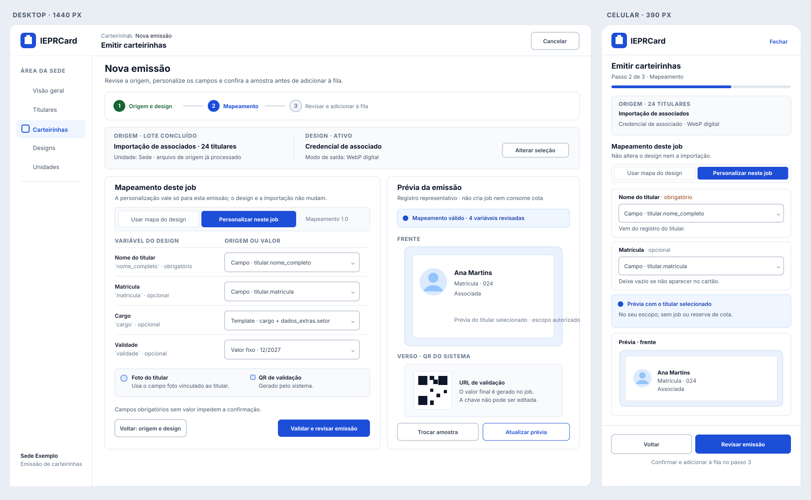

# Design e Mapeamento de Campos

## 5. Especificação do Motor de Carteirinhas e do Servidor MCP

### 5.1. Contrato JSON do Mapa de Design (`mapa_campos_json` - Req 10, 11, 17, 17.1)

Cada design armazenado em `designs_carteirinha` possui uma estrutura padronizada que serve tanto ao renderizador WebP (`GD`/`Imagick`) quanto ao renderizador PDF vetorial:

```json
{
  "versao_schema": "1.0",
  "dimensoes": { "largura_px": 1011, "altura_px": 638, "dpi": 300, "padrao": "CR80" },
  "elementos": [
    {
      "id": "el_foto",
      "lado": "frente",
      "tipo": "foto_titular",
      "chave_variavel": "foto",
      "x": 68, "y": 140, "largura": 240, "altura": 320,
      "borda_raio": 16, "borda_espessura": 4, "borda_cor": "#FFFFFF",
      "placeholder_padrao": "assets/img/avatar_default.png"
    },
    {
      "id": "el_nome",
      "lado": "frente",
      "tipo": "texto_dinamico",
      "chave_variavel": "nome_completo",
      "rotulo_amigavel": "Nome do Titular",
      "obrigatorio": true,
      "x": 340, "y": 180, "largura_max": 620,
      "fonte_arquivo": "Inter-Bold.otf", "tamanho_pt": 24,
      "cor_hex": "#0F172A", "alinhamento": "left", "transformacao": "uppercase",
      "auto_reduzir_fonte_se_longo": true
    },
    {
      "id": "el_qr",
      "lado": "verso",
      "tipo": "qrcode_validacao",
      "chave_variavel": "_sistema_url_validacao",
      "x": 760, "y": 380, "tamanho": 200,
      "margem_quiet_zone": 4
    }
  ]
}

```

#### Validação do schema 1.0

O objeto contém somente `versao_schema`, `dimensoes` e `elementos`. O JSON serializado pode ter até 256 KiB e até 100 elementos. `versao_schema` deve ser `1.0`; `dimensoes` é CR80 (`largura_px: 1011`, `altura_px: 638`, `dpi: 300`, `padrao: CR80`). O canvas usa origem no canto superior esquerdo. `elementos` pode estar vazio durante a criação de um rascunho. Quando há elementos, seus IDs são únicos e seguem `[A-Za-z][A-Za-z0-9_-]{0,63}`; `lado` é `frente` ou `verso`, e coordenadas e medidas são números finitos. `x` e `y` não podem ser negativos; largura e altura, quando aplicáveis, devem ser positivas e o elemento deve caber no canvas.

| `tipo` | Campos obrigatórios além de `id`, `lado` e `tipo` | Regras específicas |
| --- | --- | --- |
| `texto_dinamico` | `chave_variavel`, `x`, `y`, `largura_max`, `fonte_arquivo`, `tamanho_pt`, `cor_hex`, `alinhamento` | `largura_max` cabe a partir de `x`; tamanho é positivo; `fonte_arquivo` é um nome-base `.ttf` ou `.otf` (o renderizador o resolve na coleção interna); cor é `#RRGGBB`; alinhamento é `left`, `center` ou `right`. Opcionais: `rotulo_amigavel` (texto não vazio), `obrigatorio` (booleano), `transformacao` (`uppercase`, `lowercase`, `capitalize` ou `none`) e `auto_reduzir_fonte_se_longo` (booleano). |
| `foto_titular` | `chave_variavel`, `x`, `y`, `largura`, `altura` | A chave é `foto`; retângulo cabe no canvas. Opcionais: `borda_raio` e `borda_espessura` (números finitos não negativos), `borda_cor` (`#RRGGBB`) e `placeholder_padrao` (`assets/img/` seguido por nome-base `.png`, `.jpg`, `.jpeg` ou `.webp`). |
| `qrcode_validacao` | `chave_variavel`, `x`, `y`, `tamanho` | A chave é `_sistema_url_validacao`; o quadrado cabe no canvas. `margem_quiet_zone` é opcional e não pode ser negativa. |
| `codigo_barras` | `chave_variavel`, `formato`, `x`, `y`, `largura`, `altura` | Formato é `CODE128` ou `EAN13`; retângulo cabe no canvas. |

`chave_variavel` não inclui as chaves `{{ }}`. Aceita identificadores iniciados por letra ou `_`, seguidos por letras, números, `_`, `.` ou `-`, para preservar campos hierárquicos e colunas de origem do mapeamento. Variáveis reservadas do sistema são definidas neste documento. Tipos de elemento ou versões não listados são rejeitados; extensões exigem nova versão do schema.

Propriedades não listadas na tabela ou nos campos obrigatórios de cada tipo são rejeitadas. Isso evita que dados ignorados aparentem ter sido aplicados e mantém mudanças do formato sob controle de versão.

### 5.2. Resolução do Mapeamento Duplo (Requisito 17.1)

O núcleo puro `config/design_mapping.php` resolve os valores de um registro contra as variáveis presentes no design; ele não consulta banco, filesystem, tenant ou interpreta código. Os dois modos abaixo usam a mesma configuração versionada (`versao_schema: "1.0"`, objeto `mapeamentos` indexado por `chave_variavel`):

* **Modo A — Mapeamento Fixo por Layout (`mapeamento_fixo_json`):** o cliente salva no layout os campos padrão. Usa o tipo `campo` para ligar a variável a um campo do titular, como `nome_completo → nome` ou `cargo → dados_extras.cargo`. Ao selecionar titulares já presentes no banco, a emissão poderá reutilizar esse mapeamento sem uma etapa interativa.
* **Modo B — Mapeamento por job de emissão (`mapa_de_para_usado_json`):** ao gerar carteirinhas, o operador pode escolher campos do titular, combiná-los em um template ou informar um valor fixo para as variáveis do design. O JSON é salvo no job de emissão; não substitui nem altera o mapa de colunas usado na importação que criou os titulares. Sem mapa específico no job, aplica-se o mapeamento fixo do design.

O formato executável é:

```json
{
  "versao_schema": "1.0",
  "mapeamentos": {
    "nome_completo": {"tipo": "campo", "origem": "titular.nome"},
    "curso_semestre": {"tipo": "template", "partes": [{"campo": "Curso"}, " - ", {"campo": "Semestre"}, "º Sem"]},
    "validade": {"tipo": "valor", "valor": "Validade: 12/2027"}
  }
}
```

`campo` aceita caminhos de objeto separados por ponto (até 16 segmentos); segmentos são identificadores, não índices, expressões ou código. `template` aceita uma lista ordenada de strings literais e objetos `{"campo": "caminho"}`; `valor` é texto literal. O Modo A usa `campo`; o Modo B pode usar os três tipos. Os limites são 256 KiB por configuração, 100 partes por template e 8 KiB por valor resolvido. Apenas strings, números finitos e booleanos vindos do registro são convertidos em texto; arrays, objetos e `null` não são valores imprimíveis.

O motor considera somente variáveis declaradas em `elementos`. Uma variável de texto com `obrigatorio: true` precisa de mapeamento e valor não vazio; ausências geram erro estruturado com código e caminho, sem incluir dados de titulares. Variáveis opcionais sem mapeamento ou valor resolvem para string vazia. `_sistema_url_validacao` nunca aceita origem configurada pelo cliente ou job: seu valor entra separadamente pelo contexto de sistema. Em qualquer erro, nenhum mapa parcial de valores é retornado. A chave de idempotência do job também vincula o mapa: repetir a chave com outro mapeamento resulta em conflito, e as tentativas do mesmo job reutilizam o JSON persistido.

O catálogo/editor da Sede persiste mapas e mapeamentos fixos em `designs_carteirinha`. A importação persiste separadamente a relação entre colunas do arquivo e campos de titular; cada job de emissão pode persistir seu próprio mapeamento de variáveis do design em `lotes_importacao.mapa_de_para_usado_json`. A fatia backend está na [Issue #72](https://github.com/agthinkindigital/IEPRCard/issues/72); o guia funcional do wizard está em [`docs/userguide/emitir-carteirinhas.md`](userguide/emitir-carteirinhas.md). A prévia do editor usa o renderizador WebP com valores sintéticos e não consulta titulares.

### Catálogo, rascunhos e edição segura

Design criado ou editado pelo catálogo permanece com `ativo = 0`; publicação é uma ação separada. O catálogo é escopado à Sede e guarda fundos em storage privado por tenant. Designs ativos são somente leitura nesta tela. Edições de rascunhos ficam bloqueadas enquanto houver emissão vinculada em `aguardando_mapa`, `na_fila` ou `processando`, pois o worker lê o mapa e os fundos persistidos ao executar o job. A interface aprovada e suas operações estão no [guia funcional do editor](userguide/designs-carteirinhas.md).


## Telas do MVP

**Editor de designs**


**Emissão com mapeamento de campos**



