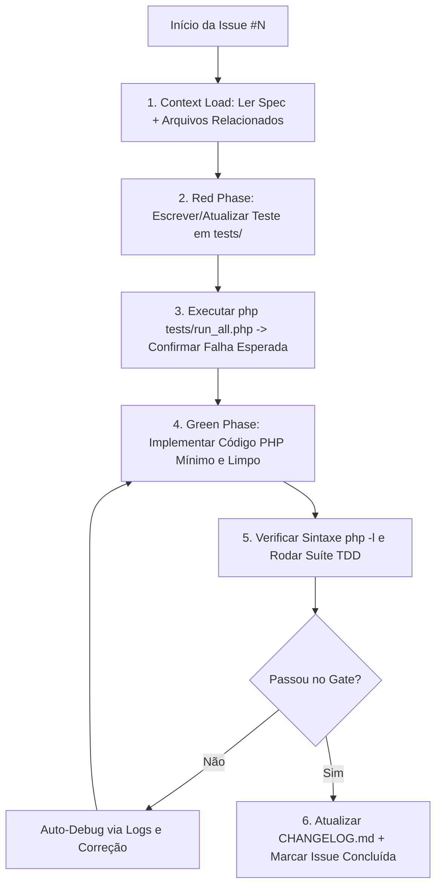

# Orquestração Agêntica

## GitHub Issues e triagem

GitHub é o tracker obrigatório. Labels de categoria: `bug`, `enhancement`. Labels de estado: `needs-triage`, `needs-info`, `ready-for-agent`, `ready-for-human`, `wontfix`; os nomes das labels correspondem diretamente aos papéis do fluxo de triagem. Cada Issue triada mantém exatamente uma categoria e um estado.

## 7. Orquestração Agêntica e Fluxo de Trabalho (Agent Workflow)

Para que um agente de IA construa este projeto sem alucinações, regressões ou perda de contexto, a execução segue um ciclo determinístico de **6 fases orquestradas**:

### Regras de Ouro para o Agente Construtor

1. **Proibição de Dependências Pesadas:** Não instalar frameworks (Laravel, Symfony). Utilizar PHP 8.1+ puro, PDO nativo, GD/Imagick nativos e bibliotecas *single-file* embutidas em `includes/libs/` para XLS/XLSX, QR Code e PDF. Parser vendorizado e respectiva decisão: [ADR-0013](adr/0013-parser-xls-legado.md).
2. **Preservação da Identidade Visual e Padrões Validados:** Manter o estilo CSS dark/moderno com variáveis (`--line`, `--teal`, `--text`, `--muted`, `.painel-box`, `.campo`, `.btn`) já presente em `ia-config.php` e `integracao-pagamento.php`.

3. **Compatibilidade SQL Estrita:** Nunca escrever queries com funções exclusivas do MySQL sem passar pelo helper de compatibilidade em `config/conn.php` (ex: usar `dbAgora()` ou parâmetros ISO `date('Y-m-d H:i:s')` do PHP em vez de `NOW()` puro quando houver diferença entre SQLite e MySQL).
4. **Segurança por Padrão:** Toda query deve usar *Prepared Statements* PDO ou sanitização centralizada; toda validação de token de webhook deve usar `hash_equals()`; toda rota de Cliente ou Subcliente deve filtrar obrigatoriamente por `tenant_id` da sessão/domínio.

---
