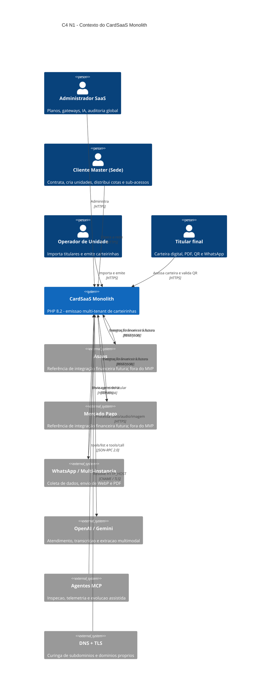
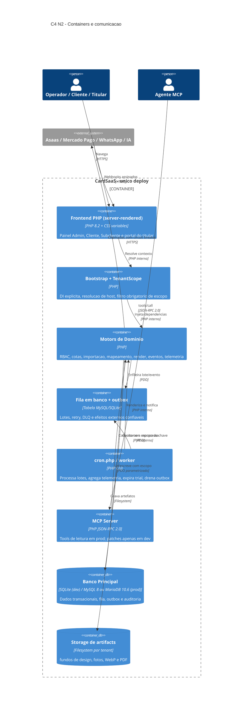
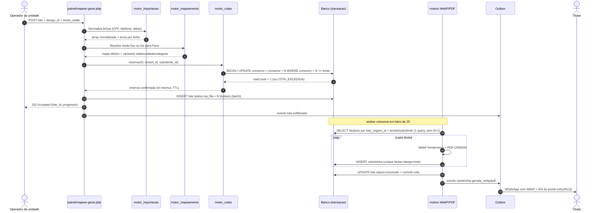

# Software Architecture Document (SAD / ADD) — CardSaaS Monolith (IEPRCard)

| Metadado | Valor |
| --- | --- |
| Versão | 1.0.0 |
| Data | 2026-11-18 |
| Status | Proposto — incorpora objetivos de disponibilidade, ciclo de vida de dados e domínios próprios; pagamentos ficam fora do MVP. SLA contratual e validação do plano de hospedagem seguem pendentes (§2.3, §7.1) |
| Fonte de verdade | `docs/00-visao-e-idealizacao.md` … `docs/17-telas-do-mvp.md` |
| Decisões vinculadas | `docs/adr/0001` … `docs/adr/0012` |
| Escopo | Greenfield: o repositório contém apenas o planejamento; não há código-fonte versionado até esta data |

> Convenção deste documento: **`[BASE]`** = decisão já presente em `docs/00-17`; **[PROPOSTO]** = decisão nova do Arquiteto, registrada em ADR, necessária para atingir production-readiness. Nenhuma premissa de volumetria, SLA ou disponibilidade foi inventada sem ser marcada como a validar.

---

## 1. Visão Geral e Contexto de Negócio

### 1.1. Objetivo

Fornecer, em um único deploy, a emissão automatizada de documentos de identificação (carteirinhas estudantis, crachás, credenciais eclesiásticas, carteiras de clubes/sindicatos) em dois formatos complementares:

- **PDF** com texto/códigos vetoriais e fotos raster para impressão CR80 individual ou A4: 8-up com 3 mm de sangria, 10-up sem sangria;
- **WebP leve** para carteira digital online, WhatsApp e validação anti-fraude por QR Code.

O valor de negócio está na hierarquia operacional: uma **Sede** contrata o plano, cria **Subclientes** (filiais, congregações, polos), distribui cotas e delega sub-acessos; o **Titular final** recebe apenas a carteirinha e, quando liberado, acessa diretamente a própria carteira digital.

### 1.2. Escopo, personas e fluxos críticos

| Camada | Persona | O que faz no sistema | Restrição estrutural |
| --- | --- | --- | --- |
| 1 | Administrador SaaS | Planos, preços, gateways, IA, MCP, auditoria global, telemetria, cortesia/trial | `tenant_id = NULL` |
| 2 | Cliente Master (Sede) | Contrata, cria Subclientes, cria **todos** os sub-acessos, distribui cotas, vê a rede | `tenant_id = ID`, `subcliente_id = NULL` |
| 3 | Responsável do Subcliente | Opera apenas a própria unidade | `subcliente_id = ID` fixado no backend |
| 4 | Sub-acesso da Sede / do Subcliente | Permissões granulares delegadas pelo Cliente Master | interseção com o teto do Cliente |
| 5 | Titular final | Login direto na própria carteirinha, download, QR, WhatsApp | `acesso_app_liberado = 1` |

Fluxos críticos (detalhados em §4.3 a §4.5):

1. **F1 — Emissão em lote:** importação (CSV/XLS/XLSX/JSON) → normalização/validação → mapeamento De→Para → débito atômico de cota → render WebP/PDF → entrega (download, portal, WhatsApp).
2. **F2 — Cobrança SaaS (futura, fora do MVP):** checkout → webhook assinado e idempotente → transição de estado da conta → propagação para Subclientes. Nenhuma cobrança ou webhook de Asaas/Mercado Pago será implementado no lançamento; ver `docs/07`.
3. **F3 — Validação pública:** leitura do QR → verificação de estado (ativa/suspensa/vencida/revogada) → auditoria de portaria sem expor CPF.
4. **F4 — Acesso do titular:** login por CPF + data de nascimento/senha ou token único → aterrissagem direta na carteirinha da própria unidade com variáveis `{{sede.*}}` e `{{unidade.*}}` injetadas.

### 1.3. Stakeholders

| Stakeholder | Interesse principal | Artefato de referência |
| --- | --- | --- |
| Dono do SaaS (Admin) | MRR, inadimplência, consumo de cota, segurança | `docs/07`, `docs/08` |
| Cliente Master | Produzir e delegar sem criar 6 artes diferentes | `docs/01`, `docs/06` |
| Operador de unidade | Importar e emitir com poucos cliques | `docs/11` (ISSUE-007 a 012) |
| Titular | Carteirinha acessível e validável | `docs/01` §5, `docs/16` |
| Agente/roteador de IA | Evoluir o sistema com segurança | `docs/09`, `docs/13` |

### 1.4. Conflitos reconhecidos na base documental e resolução arquitetural

A arqueologia de `docs/00-17` encontrou divergências que **devem** ser fechadas antes da primeira issue de código, sob pena de retrabalho e regressão:

| # | Conflito | Onde | Resolução adotada neste SAD | ADR |
| --- | --- | --- | --- | --- |
| C1 | Dois ERDs com nomes diferentes para o mesmo conceito: `tenant_id` vs `cliente_sede_id`; `USUARIOS` vs `USUARIOS_EQUIPE` | `docs/03` §2.1 e §4 | Nome canônico: `tenant_id` = Cliente Sede; `subcliente_id` nullable = unidade; tabela `usuarios` com `perfil_acesso_id` | 0005 |
| C2 | `TDD-01` esperava "todas as 15 tabelas", divergindo do schema canônico | `docs/10` TDD-01 × antigo `docs/03` | Resolvido: TDD-01 verifica o catálogo MVP e `docs/03` aponta às fontes canônicas sem duplicar ERD | 0005 |
| C3 | Credenciais em `configuracoes_pagamento` (linha única `id=1`) vs `configuracoes_gateway` | `docs/03` §2.2 × `docs/07` | `configuracoes_gateway` é o nome canônico do modelo financeiro futuro; fora do schema MVP | 0005 |
| C4 | Máquina de estados financeira divergente: `ativo/pendente/vencido/bloqueado` × `trial → ativo → inadimplente → suspenso → cancelado` × `cortesia` | `docs/03`, `docs/07`, `docs/01` | Estado-alvo único `status_conta` + `regime_cobranca` + `isento_pagamento`; no MVP, ativação manual. Ver §5.4 | 0008 |
| C5 | RBAC em `includes/rbac.php` (pode()) × `includes/motor_permissoes.php` (tabelas `papeis`/`permissoes`) | `docs/04` × `docs/02` | Um único motor `motor_permissoes.php` expondo `pode()`; tabelas `perfis_acesso`/`permissoes`/`usuario_permissoes` | 0004 |
| C6 | Evento `permissao.alterada` invalida cache, mas não está no catálogo de eventos | `docs/04` × `docs/05` | Incluir no catálogo; cache de RBAC por requisição | 0004 |
| C7 | *Self-healing* automático de schema é descrito como mecanismo de produção | `docs/02`, `docs/11` ISSUE-002 | Restrito a dev/test; produção usa migrações versionadas expand-only | 0010 |
| C8 | `mcp.code.safe_patch` aplica patches e roda testes no servidor | `docs/09`, `docs/11` ISSUE-017 | Disponível somente em dev/staging; em produção apenas tools de leitura | 0009 |
| C9 | Suítes TDD contadas como 7, mas existe `TDD-02B` | `docs/10` × `docs/14` | 8 suítes canônicas (TDD-01…07 + 02B) | 0012 |
| C10 | Nenhuma seção de disponibilidade, RPO/RTO, backup, deploy, CSRF/CSP, correlation id ou rate limiting | ausente em `docs/00-17` | Proposto em §2, §6, §7, §8 e §10 | 0006, 0011, 0012 |

---

## 2. Requisitos Não Funcionais (NFRs) e Restrições

### 2.1. NFRs com origem documental

| ID | NFR | Meta | Origem |
| --- | --- | --- | --- |
| NFR-01 | Compatibilidade de banco | Alternar `DB_DRIVER=sqlite\|mysql` sem alterar nenhum arquivo consumidor | `docs/11` ISSUE-001 |
| NFR-02 | Paridade e portabilidade de dados | Catálogo versionado comum em SQLite e MySQL; self-healing apenas em dev/test, drift sem DDL em produção e cópia validada por contagem/checksum | TDD-01, ADR-0005, ADR-0010 |
| NFR-03 | Volume planejado | > 50.000 carteirinhas/mês em VPS 2 vCPU / 4 GB RAM | `docs/14` |
| NFR-04 | Performance de render | ≤ 80 ms por carteirinha WebP (frente+verso); ≤ 3,5 s para lote PDF de 50 no runner PHP 8.2 isolado | `docs/12` GATE 3; ADR-0007 |
| NFR-05 | Importação | 500 registros em CSV, XLS, XLSX e JSON sem estourar memória; 1.000+ em lotes de 25 via AJAX | `docs/11` ISSUE-007, `docs/16` |
| NFR-06 | Isolamento | Nenhum Subcliente lê/edita dados de outro Subcliente ou Cliente, mesmo manipulando IDs | `docs/12` GATE 2 |
| NFR-07 | Idempotência de webhook financeiro | Mesmo `event.id` processado 2× não duplica cobrança nem estado; requisito da fase futura de pagamentos | `docs/07`, ADR-0008 |
| NFR-08 | Segurança de token | Validação de tokens/assinaturas aplicáveis ao módulo em questão; credenciais financeiras cifradas quando integração for priorizada | `docs/13`, ADR-0008 |
| NFR-09 | Privacidade | Sem PII em telemetria/logs; aplicar o ciclo de vida dos dados de `docs/01` | `docs/01-regras-de-negocio.md`, `docs/08-telemetria.md`, ADR-0012 |
| NFR-10 | Testabilidade | Nenhum módulo de negócio pronto sem passar em `tests/run_all.php` (SQLite efêmero + MySQL) | `docs/10` |
| NFR-11 | Quality gates | Avanço de fase condicionado a `PASS` nos Gates 1–5 | `docs/12` |
| NFR-12 | Restrição de stack | PHP 8.1+/8.2 puro, PDO, GD, MySQL, cron agendável e storage privado; proibido depender de daemon, Docker ou acesso root no perfil compartilhado | `docs/13`, `docs/14`; alinhamento de hospedagem |
| NFR-13 | White-label | Em Hospedado, domínio próprio/subdomínio com branding por host validado; Local Host opera uma Sede configurada sem hostname público | `docs/00`, `docs/16`, ADR-0003 |

### 2.2. NFRs propostos para production-readiness **[PROPOSTO]**

| ID | NFR | Meta proposta | Justificativa / trade-off |
| --- | --- | --- | --- |
| NFR-14 | Latência de interação | p95 < 300 ms em páginas autenticadas; p95 < 2 s para POST que inicia lote; p99 < 1 s em leitura de QR | Sem proxy reverso cacheável em dado de tenant; medir no gateway para incluir PHP-FPM |
| NFR-15 | Disponibilidade | Objetivo interno aceito: 99,5% mensal no MVP; 99,9% só com arquitetura redundante | Condições e limites do perfil compartilhado em ADR-0012 |
| NFR-16 | Recuperação | Objetivo interno aceito: RPO ≤ 1 h e RTO ≤ 4 h; evolução condicionada a alta disponibilidade | Requer cópia externa e restore demonstrado; ver ADR-0012 |
| NFR-17 | Concorrência de cota | Débito de cota linearizável; zero emissão acima do teto sob requisições simultâneas | `UPDATE ... WHERE consumo < limite` + unique key; ver §5.3 |
| NFR-18 | Resiliência de integração | Timeout ≤ 5 s, 3 tentativas com backoff exponencial, circuit breaker e DLQ para integrações externas ativas; Asaas/MP ficam fora do MVP | Evita que serviço externo derrube o request do operador |
| NFR-19 | Observabilidade | 100% dos logs estruturados com `correlation_id`, `tenant_id`, `subcliente_id`; golden signals por endpoint | Ver §8 |
| NFR-20 | Segurança de transporte/navegador | TLS obrigatório, HSTS, CSP, `SameSite=Lax`, CSRF token em todo POST autenticado, `HttpOnly`+`Secure` em sessão | Base não cita CSRF/CSP; risco OWASP real |
| NFR-21 | Rate limiting | 60 req/min por IP em login/QR e endpoints de webhook ativos; burst configurável | Mitiga força bruta e abuso de validação pública |
| NFR-22 | Deploy | Atualização reversível; troca atômica quando suportada, janela curta de manutenção no perfil compartilhado se necessário; rollback testado | Ver §7.3 |
| NFR-23 | Auditoria | Toda mudança de permissão, cota, plano e acesso de suporte gera linha em `auditoria_processos` | `docs/01` §6 e `docs/04` |
| NFR-24 | Operação de lotes | Exibir lote recomendado e pico previsto; permitir ajuste manual aplicado após reinício do worker | Alinhamento do produto; ADR-0011 |
| NFR-25 | Compatibilidade de hospedagem | Aplicação operável em hospedagem compartilhada PHP/MySQL com tarefas agendadas; processamento retomável e idempotente | Alinhamento do produto; §7.1 e ADR-0012 |
| NFR-26 | Perfis de instalação | Superadmin escolhe Hospedado (múltiplos tenants por hostname validado) ou Local Host (uma Sede e suas unidades, sem hostname público); ambos preservam TenantScope e sessão | Alinhamento do produto; ADR-0003 |

### 2.3. Alinhamentos confirmados e decisões ainda abertas

**Alinhamentos confirmados pelo dono do produto:**

1. **Carga operacional:** painel Admin com dados diários, lote recomendado e pico previsto na janela X; ajustes manuais aplicam após pedido de reinício do worker. O cálculo e o comportamento estão definidos em ADR-0011.
2. **SLA e recuperação:** objetivos internos de NFR-15/16 aceitos, sem compromisso comercial. Viabilidade no plano e condições de medição estão em ADR-0012.
3. **Dados pessoais:** política em `docs/01`; requisitos de backup e restauração em ADR-0012.
4. **MCP:** disponível desde o primeiro lançamento, inclusive em produção, com as restrições do ADR-0009: produção somente com ferramentas de leitura; escrita requer aprovação humana e alteração de código remoto continua indisponível.
5. **Região:** uma única região atende ao lançamento; multirregião não é requisito.
6. **Domínios:** domínios próprios dos Clientes são requisito do lançamento. Cada domínio deve ser verificado, vinculado unicamente a um tenant e servido com TLS; a hospedagem precisa aceitar múltiplos nomes apontando para a mesma aplicação.
7. **Pagamentos:** cobranças SaaS, cobranças de titulares e repasses estão fora do MVP. O fluxo plataforma→Cliente por marketplace/split é apenas uma direção futura, descrita em `docs/07` e ADR-0008; o código de webhook existente será referência para avaliação, sem integração no lançamento.
8. **Perfil da instalação:** superadmin seleciona Hospedado ou Local Host. O perfil local atende somente uma Sede ativa e suas unidades, não exige hostname público e não aceita resolução por host vindo de fora do loopback. O perfil hospedado conserva o roteamento validado por `HTTP_HOST`. Ver ADR-0003.

**Decisões ainda abertas antes dos respectivos módulos:**

1. **Fotos:** qual o tamanho médio e o pico de upload por lote ZIP? Define limites de upload, storage e limpeza.
2. **Validação do perfil Hospedado:** demonstrar DNS, aliases e TLS em um ambiente de teste sob controle do mantenedor; validar também limites PHP, cron, storage privado e uploads no host real. A configuração de instalação permite testar Local Host sem hostname, mas isso não comprova DNS/TLS do perfil Hospedado; a evidência permanece na [#51](https://github.com/agthinkindigital/IEPRCard/issues/51).
3. **Financeiro (fase futura):** selecionar e habilitar produto de marketplace, definir comissão, periodicidade do repasse e responsabilidades por estornos/chargebacks antes de implementar pagamentos.

---

## 3. Padrões e Estilo Arquitetural

### 3.1. Padrão principal: Modular Monolith em camadas estritas **[BASE + PROPOSTO]**

```
Entrypoints (index.php, admin/*, painel/*, carteira/*, webhooks, cron, mcp)
        ↓ (dependem de)
Config / Bootstrap (conn.php, schema_self_healing.php, tenant_resolver.php, DI)
        ↓
Core Includes (motor_eventos, motor_permissoes, motor_cotas, motor_telemetria, motor_importacao, motor_mapeamento)
        ↓
Motors de Domínio (motor_carteirinha_webp, motor_carteirinha_pdf, motor_conversa_menu, motor_ia_atendimento; financeiro futuro)
        ↓
Wrappers externos ativos conforme escopo (api/openai, api/gemini, api/whatsapp; Asaas/MP futuros)
        ↓
Infraestrutura (PDO dual, filesystem de tenants, fila em banco)
```

**Justificativa.** Com 17 issues, 8 suítes TDD e um único time, o custo de malha de rede, contratos gRPC e deploy distribuído de microserviços não se paga. O monólito mantém transações ACID locais para débito de cota + emissão — exatamente onde a consistência é crítica — e reduz a superfície de ataque. **Contras aceitos:** escala vertical (não há scale-out independente do renderizador), acoplamento de deploy e risco de "big ball of mud" se os limites de módulo não forem respeitados. Mitigação: fronteiras explícitas de módulo, testes de isolamento (GATE 2) e extração futura do renderizador via Strangler Fig, com ADR próprio. Ver ADR-0001.

### 3.2. Convenções de código e limites

- **Composição explícita:** `config/bootstrap.php` **[PROPOSTO]** instancia PDO, resolvers, motors e repositórios e injeta por parâmetro/construtor. É proibido `Service Locator` global, `singleton` arbitrário e `include` que esconde dependência.
- **Arquivos > 250 linhas** devem ser desmembrados dentro do próprio pacote (`models.php`, `interfaces.php`, `service.php` ou, em PHP, `motor_*.php`, `repository_*.php`, `dto_*.php`).
- **ZERO pseudocódigo:** nada de `// ...` ou "implementação futura" em código ou especificação de issue.
- **SQL dual:** nenhuma função exclusiva de MySQL (`NOW()`, `IFNULL`, `GROUP_CONCAT` com sintaxe própria) sem passar pelo helper de compatibilidade em `config/conn.php` (`dbAgora()` etc.). Parâmetros PDO sempre.
- **Erros:** exceções de domínio com código estável (`COTA_EXCEDIDA`, `TENANT_FORA_DE_ESCOPO`, `WEBHOOK_INVALIDO`); `try/catch` na borda do entrypoint convertendo para resposta HTTP/documento de erro estruturado. Nunca engolir exceção em motor de cota/pagamento.
- **Nomes:** tabelas e colunas em `snake_case`; eventos em `dominio.acao_passado`; permissões em `recurso.acao`; rotas de arquivo em `kebab-case.php`.
- **Teste reverso:** antes de alterar qualquer módulo, ler a suíte correspondente em `tests/` como especificação viva.

### 3.3. Mapa de responsabilidades

Esta tabela descreve responsabilidades lógicas do alvo arquitetural, não um inventário de arquivos nem uma declaração do que já está implementado. Estado executável deve ser conferido no código e nas Issues vinculadas ao roadmap.

| Módulo | Responsabilidade | Não faz |
| --- | --- | --- |
| Resolução de tenant | Resolver host para Admin/Cliente/Subcliente e seu branding | Não decide permissão |
| RBAC | Aplicar permissões e tetos descendentes | Não substitui filtros de escopo em consultas |
| Escopo **[PROPOSTO]** | Construir filtros obrigatórios de tenant/unidade em consultas de negócio | Não conhece regras de negócio |
| Cotas | Aplicar tetos, pool/alocações e reservas atômicas | Não cobra pagamento |
| Eventos e outbox **[PROPOSTO]** | Persistir eventos de domínio e efeitos externos na mesma transação | Não chama APIs externas na transação |
| Importação | Validar e persistir titulares a partir de arquivos suportados | Não renderiza carteirinhas |
| Mapeamento | Resolver campos do titular para elementos do design | Não persiste a emissão |
| Renderização | Gerar WebP e PDF nos formatos definidos | Não decide permissões ou cotas |
| Pagamentos (futuro) | Avaliar checkout, cobrança, idempotência e estados após priorização | Não faz parte do MVP nem altera status de conta |
| Telemetria | Registrar eventos permitidos e agregar métricas sem PII | Não armazena dados pessoais |
| MCP | Expor ferramentas autenticadas com escopos e auditoria | Não executa patch em produção |

---

## 4. Visão de Arquitetura (C4 Model)

### 4.1. C4 Nível 1 — Contexto



### 4.2. C4 Nível 2 — Contêineres



### 4.3. Sequência — F1: emissão em lote com débito atômico de cota



### 4.4. Referência futura — F2: webhook de pagamento idempotente

Sequência de referência para uma fase posterior; checkout e webhooks financeiros não integram o MVP.

```mermaid
sequenceDiagram
    autonumber
    participant GW as Asaas / Mercado Pago
    participant Hook as webhook_*.php
    participant DB as Banco
    participant Evt as motor_eventos
    actor Adm as Administrador

    GW->>Hook: POST payload + assinatura + event.id
    Hook->>Hook: hash_equals(token/HMAC) + janela de timestamp
    alt assinatura invalida
        Hook-->>GW: 401 (sem gravar nada)
    else valida
        Hook->>DB: INSERT IGNORE webhooks_recebidos(event_id, payload_hash)
        alt evento ja processado
            DB-->>Hook: 0 linhas
            Hook-->>GW: 200 OK (no-op idempotente)
        else novo evento
            DB-->>Hook: 1 linha
            Hook->>DB: BEGIN; UPDATE pagamentos_saas; UPDATE tenants status_conta
            Hook->>Evt: pagamento.saas_confirmado / vencido
            Evt->>DB: propaga estado para subclientes filhos + telemetria
            Hook->>DB: COMMIT
            Hook-->>GW: 200 OK
        end
    end
    Note over Adm,DB: cortesia_admin (isento_pagamento=1) ignora eventos de bloqueio
    Adm->>DB: auditoria.registro (quando, antes, depois)
```

### 4.5. Sequência — F3/F4: acesso do titular e validação pública

```mermaid
sequenceDiagram
    autonumber
    actor Tit as Titular
    participant Portal as carteira/index.php
    participant Val as carteira/validar.php
    participant Scope as TenantScope
    participant DB as Banco

    Tit->>Portal: CPF + data nascimento OU token_unico_carteira
    Portal->>Scope: resolve tenant/subcliente do host ou token
    Scope->>DB: valida tenant/unidade, acesso liberado e titular ativo
    Scope->>DB: SELECT carteirinhas ativas e vigentes do titular no mesmo escopo
    DB-->>Portal: carteirinha(s) do titular
    Portal->>Portal: injeta {{sede.*}}, {{unidade.*}}, {{titular.categoria}}
    Portal-->>Tit: WebP frente/verso, QR dinamico, PDF se permitido
    Tit->>Val: le QR (codigo_validacao_qr)
    Val->>DB: SELECT carteirinha + titular + tenant/unidade e conferir a mesma hierarquia
    Note over Val,DB: Divergência de escopo ou unidade falha fechada como suspensa
    alt ativa e dentro da validade e conta adimplente
        Val-->>Tit: JSON status=ativa, motivo_codigo=ativa
    else suspensa/vencida/revogada
        Val-->>Tit: JSON com estado público e motivo genérico, sem dados pessoais
    end
    Val->>DB: UPDATE atômico do contador + auditoria minimizada por tenant/unidade
    Note over DB: Sem ID de titular/carteirinha, token, IP ou User-Agent; rate limit usa hash efêmero de IP
```

A leitura privada deriva o titular da sessão `IEPRCARDPORTAL`, revalida acesso, tenant e unidade no banco e não aceita IDs de titular enviados pelo cliente. A entrega de frente/verso WebP usa `/portal/carteirinha/{id}/{lado}`: o ID só seleciona uma carteirinha já autorizada pela consulta da sessão e o arquivo é lido pelo resolvedor privado do tenant; respostas são `private, no-store`. O token individual é bearer de 32 bytes: somente seu digest SHA-256 fica em `titulares.token_unico_carteira`.

### 4.6. DER-alvo do produto (schema do MVP definido no ADR-0005)

O diagrama mostra o modelo completo previsto. No MVP, não criar `pagamentos_saas`, `pagamentos_titular`, `contas_recebedoras`, `repasses_titular` nem `configuracoes_gateway`; cobrança, checkout e webhooks Asaas/Mercado Pago ficam para fase futura. O contrato inicial de banco é o conjunto reduzido descrito no ADR-0005.

Este DER expressa as relações conceituais. A definição executável de colunas, tipos, índices e chaves estrangeiras está no [catálogo de schema](../../database/schema/), que é a referência para criação e inspeção em SQLite e MySQL/MariaDB.

```mermaid
erDiagram
    PLANOS ||--o{ TENANTS : define_teto
    PLANOS ||--o{ PLANO_FEATURE_FLAGS : limita
    TENANTS ||--o{ TENANTS : sede_tem_subclientes
    TENANTS ||--o{ DOMINIOS_TENANT : recebe_hosts
    TENANTS ||--o{ PERFIS_ACESSO : define
    TENANTS ||--o{ USUARIOS : aloca
    PERFIS_ACESSO ||--o{ USUARIOS : aplica_rbac
    USUARIOS ||--o{ USUARIO_PERMISSOES : override
    TENANTS ||--o{ CATEGORIAS_TITULAR : classifica
    CATEGORIAS_TITULAR ||--o{ TITULARES : tipifica
    TENANTS ||--o{ TITULARES : gerencia
    TENANTS ||--o{ DESIGNS_CARTEIRINHA : possui
    DESIGNS_CARTEIRINHA ||--o{ LOTES_IMPORTACAO : usa
    TENANTS ||--o{ LOTES_IMPORTACAO : executa
    LOTES_IMPORTACAO ||--o{ CARTEIRINHAS_EMITIDAS : origina
    TITULARES ||--o{ LOTES_IMPORTACAO : origem_individual_do_job
    DESIGNS_CARTEIRINHA ||--o{ CARTEIRINHAS_EMITIDAS : renderiza
    TITULARES ||--o{ CARTEIRINHAS_EMITIDAS : possui
    TITULARES ||--o{ PAGAMENTOS_TITULAR : paga_taxa
    TENANTS ||--o{ CONTAS_RECEBEDORAS : recebe_liquidacao
    PAGAMENTOS_TITULAR ||--o{ REPASSES_TITULAR : liquida_para_tenant
    CONTAS_RECEBEDORAS ||--o{ REPASSES_TITULAR : destino
    TENANTS ||--o{ PAGAMENTOS_SAAS : paga_assinatura
    TENANTS ||--o{ TELEMETRIA_EVENTOS : gera
    TENANTS ||--o{ AUDITORIA_PROCESSOS : registra
    TENANTS ||--o{ ACESSOS_SUPORTE : autoriza
    TENANTS ||--o{ MENSAGENS_WHATSAPP : conversa
    TENANTS ||--o{ CONFIGURACOES_GATEWAY : configura
    TENANTS ||--o{ MCP_API_KEYS : credencia_agentes
    CONFIGURACOES_OPERACIONAIS ||--o{ METRICAS_LOTES_DIARIAS : referencia_versao

    TENANTS {
        int id PK
        int parent_id FK "NULL=Sede; ID=Subcliente"
        int plano_id FK
        varchar tipo "cliente | subcliente"
        varchar status_conta "ativo|trial|pendente|vencido|suspenso|bloqueado"
        varchar regime_cobranca "assinatura|plano_unico|trial|cortesia_admin"
        int isento_pagamento
        datetime trial_expira_em
        int limite_subclientes
        int limite_usuarios_equipe
        int limite_titulares
        int limite_carteirinhas
        int consumo_titulares
        int consumo_carteirinhas
        text permissoes_unidade_json
    }

    DOMINIOS_TENANT {
        int id PK
        int tenant_id FK
        varchar hostname UK "normalizado"
        varchar estado "pendente_verificacao|verificado|tls_pendente|ativo|revogado"
        varchar token_verificacao_hash
        datetime verificado_em
        datetime tls_validado_em
        datetime criado_em
    }

    TITULARES {
        int id PK
        int tenant_id FK "Sede"
        int subcliente_id FK "NULL=Sede"
        int categoria_id FK
        varchar cpf
        varchar token_unico_carteira UK "digest SHA-256; token bruto apenas no link"
        varchar foto_url
        int acesso_app_liberado
        int ativo
    }

    CARTEIRINHAS_EMITIDAS {
        int id PK
        int tenant_id FK
        int subcliente_id FK
        int titular_id FK
        int design_id FK
        int lote_id FK
        varchar codigo_validacao_qr UK
        varchar status_carteirinha "ativa|vencida|revogada|suspensa"
        text snapshot_dados_json
    }

    LOTES_IMPORTACAO {
        int id PK
        int tenant_id FK
        int subcliente_id FK
        int lote_origem_id FK "lote de entrada; exclusivo com titular_origem_id"
        int titular_origem_id FK "origem individual opcional do job"
        varchar status_lote "aguardando_mapa|na_fila|processando|concluido|falha|cancelado|expirado"
        int total_registros
        int processados_sucesso
        int processados_erro
    }

    PAGAMENTOS_TITULAR {
        int id PK
        int tenant_id FK
        int subcliente_id FK
        int titular_id FK
        varchar gateway
        varchar external_id UK
        decimal valor
        varchar status
        datetime confirmado_em
    }

    CONTAS_RECEBEDORAS {
        int id PK
        int tenant_id FK UK
        varchar gateway
        varchar external_account_id
        text credencial_cifrada "quando necessária"
        varchar status "pendente|ativa|bloqueada|revogada"
        datetime habilitada_em
        datetime atualizado_em
    }

    REPASSES_TITULAR {
        int id PK
        int tenant_id FK
        int pagamento_titular_id FK
        int conta_recebedora_id FK
        varchar chave_idempotencia UK
        varchar external_transfer_id
        decimal valor_liquido
        varchar status "pendente|confirmado|falhou|revertido"
        datetime confirmado_em
        datetime atualizado_em
    }

    AUDITORIA_PROCESSOS {
        int id PK
        int tenant_id FK
        int subcliente_id FK
        int ator_usuario_id FK
        varchar acao
        text antes_json
        text depois_json
    }

    WEBHOOKS_RECEBIDOS {
        int id PK
        varchar evento_id UK
        varchar origem
        varchar payload_hash
        datetime processado_em
    }

    OUTBOX_EVENTOS {
        int id PK
        varchar evento_chave
        text payload_json
        varchar status "pendente|enviado|falhou|dlq"
        int tentativas
        datetime proxima_tentativa_em
    }

    CONFIGURACOES_OPERACIONAIS {
        int id PK
        int versao UK
        varchar ambiente
        text configuracao_json
        varchar estado "pendente|reinicio_solicitado|ativa|substituida"
        int alterado_por_usuario_id FK
        datetime criado_em
        datetime ativado_em
    }

    METRICAS_LOTES_DIARIAS {
        int id PK
        date dia
        varchar ambiente
        int pico_demanda_diario
        int registros_processados
        int duracao_media_ms
        int fila_maxima
        int falhas
        int versao_configuracao_id FK
    }

    SOLICITACOES_ANONIMIZACAO {
        int id PK
        varchar solicitacao_id UK
        text referencia_titular_cifrada
        varchar estado "pendente|processando|concluida|falha"
        datetime solicitado_em
        datetime prazo_em
        datetime concluido_em
        int tentativas
        varchar correlation_id
    }
```

> Regra de nomenclatura: dentro de `tenants`, a hierarquia é expressa por `parent_id`; em todas as tabelas filhas, `tenant_id` é sempre o Cliente Sede e `subcliente_id` (quando presente) é a unidade operacional. Ver ADR-0005.

---

## 5. Estratégia de Dados e Persistência

### 5.1. Banco e compatibilidade

- **Dev/test:** SQLite com `PRAGMA journal_mode=WAL`, `foreign_keys=ON`, arquivo efêmero em `/tmp` na suíte TDD.
- **Produção:** MySQL 8.0 / MariaDB 10.6+, `InnoDB`, `utf8mb4_unicode_ci`, timezone UTC no servidor e datas ISO gravadas pelo PHP (`dbAgora()`).
- **Abstração:** `config/conn.php` expõe `dbQuery`, `dbFetchOne`, `dbFetchAll`, `dbExecute`, `dbInsertId`, `dbAgora`. Todo SQL é parametrizado; zero `ENUM` (usa `VARCHAR(30)` + validação de domínio em PHP).
- **Trade-off:** a compatibilidade dual impede recursos poderosos (JSONB/GIN, `ON DUPLICATE KEY` específico, `RETURNING`), mas garante portabilidade e testes rápidos. Quando um recurso nativo for necessário, ele fica atrás de um helper com implementação por driver, nunca espalhado pelo código.

### 5.2. Isolamento multitenant

1. `tenant_resolver.php` define `contexto = {admin|cliente|subcliente}`, `tenant_id`, `subcliente_id` a partir de `HTTP_HOST` **e** da sessão autenticada.
2. `TenantScope` constrói a cláusula obrigatória: para Cliente, `WHERE tenant_id = :tid`; para Subcliente, `WHERE tenant_id = :tid AND subcliente_id = :sid`; para Admin, escopo explícito por filtro de tela (nunca "sem WHERE" por padrão).
3. Nenhum endpoint aceita `tenant_id`/`subcliente_id` do corpo/query para fins de autorização. IDs recebidos são apenas filtros dentro do escopo resolvido.
4. **RLS nativo não é usado:** SQLite não tem RLS e MySQL 8 não oferece RLS equivalente ao PostgreSQL; a imposição é na camada de acesso a dados, com testes negativos (GATE 2). Trade-off: uma query escrita fora do TenantScope pode vazar — por isso o helper é obrigatório e revisado via lint/QA.
5. Arquivos de importação e ZIPs opcionais de fotos ficam em storage privado fora de `public/`, sob chave opaca por tenant; validar `realpath()` e não seguir symlinks. O `IEPR_PRIVATE_STORAGE_PATH` aceita diretório absoluto do host e o padrão local é `var/private/`. ZIPs limitados são validados na confirmação e associados por CPF/matrícula; as fotos confirmadas recebem referências privadas aleatórias. Lotes não confirmados expiram após 24 h e removem também o ZIP temporário; fotos confirmadas seguem a retenção/anônimização do titular.

### 5.3. Consistência, concorrência e cotas

- **Operação de débito linearizável:** `UPDATE tenants SET consumo_carteirinhas = consumo_carteirinhas + :n WHERE id = :tid AND consumo_carteirinhas + :n <= limite_carteirinhas`. `rowCount() === 1` confirma a reserva; caso contrário, `COTA_EXCEDIDA` antes de qualquer gravação. Funciona em SQLite e MySQL sem `FOR UPDATE`.
- **Confirmação de importação:** o lote privado é reanalisado e até 500 titulares são validados e gravados com auditoria em uma transação sob o lock/cota da Sede. O ZIP opcional associa fotos pelo nome do arquivo (CPF ou matrícula mapeados); entradas sem correspondência, ambíguas ou inválidas rejeitam a confirmação sem criar titulares. Imagens confirmadas são armazenadas fora de `public/` e referenciadas por chave aleatória em `titulares.foto_url`. O mapeamento, contagem e estado `concluido` confirmam na mesma transação; o limite de 25 da API de cadastro em chunks permanece separado. Fonte e ZIP temporários são removidos após o commit e o cleanup pode repetir a remoção. Ver [Issue #48](https://github.com/agthinkindigital/IEPRCard/issues/48).
- **Pool compartilhado vs cota cravada:** `subcliente.limite_carteirinhas = NULL` consome do saldo da Sede; quando preenchido, a soma das cotas filhas é validada no backend (`Σ cota_filha ≤ teto_sede`).
- **Idempotência e QR da emissão:** cada pedido cria um job de lote próprio ligado à origem e ao design; a chave do pedido é persistida como hash por tenant. Semântica, limites e worker CLI/cron estão em ADR-0007 e Issue #46. Cada QR usa um token aleatório independente (32 bytes CSPRNG), persistido em `codigo_validacao_qr`; índices únicos em `(titular_id, design_id, lote_id)` e `codigo_validacao_qr` impedem duplicação de saída no retry. Implementação: Issue #53, commit `23e819a`.
- **Transação:** reserva de cota e inserção do lote são atômicas; o worker confirma a reserva ao concluir ou libera somente a reserva do job após três falhas, compensando os artefatos parciais.
- **Leituras de QR:** `UPDATE ... total_leituras_qr = total_leituras_qr + 1` (atômico) + linha de auditoria; sem `SELECT` seguido de `UPDATE` solto.
- **Origem do lote:** `titulares.lote_origem_id` vincula cada titular importado ao lote que o criou, sem duplicar PII. Job de lote deriva os membros dessa origem e valida tenant/unidade; job individual usa `lotes_importacao.titular_origem_id` e revalida o mesmo escopo. As duas referências de origem do job são mutuamente exclusivas. Titulares manuais mantêm `lote_origem_id = NULL`.
- **N+1:** carregar titulares do lote por `lote_origem_id` e escopo em uma query; designs e categorias em mapa único por requisição; nunca `dbFetchOne` dentro de `foreach` de titular.

### 5.4. Máquina de estado da conta (canônica)

As transições financeiras abaixo são modelo-alvo futuro. No MVP, a conta é ativada/suspensa/encerrada manualmente pelo Administrador e nenhum webhook de pagamento altera `status_conta`.

| `regime_cobranca` | `status_conta` inicial | Transições | Efeito em webhook |
| --- | --- | --- | --- |
| `assinatura_recorrente` | `pendente` → `trial` → `ativo` | `ativo → vencido → suspenso → cancelado` (reativação manual pelo Admin) | `PAYMENT_CONFIRMED` ativa; `PAYMENT_OVERDUE` vence após carência |
| `plano_unico` | `pendente` → `ativo` | `ativo → suspenso` (manual) | Confirmação ativa sem vencimento mensal; consome pacote |
| `trial_gratis` | `trial` | `trial → ativo \| vencido` | `trial_expira_em` via cron |
| `cortesia_admin` | `ativo` (`isento_pagamento=1`) | somente Admin reverte | **Ignora** webhooks de bloqueio |

Estados propagados para todos os Subclientes filhos; `carteirinha.status_carteirinha` passa a `suspensa` quando a Sede fica inadimplente, mas carteirinhas já emitidas continuam rastreáveis.

### 5.5. Indexação, pool e cache

| Tabela | Índice | Consulta atendida |
| --- | --- | --- |
| `titulares` | `(tenant_id, subcliente_id, ativo)` + `(tenant_id, cpf)` | listas filtradas e busca por CPF |
| `carteirinhas_emitidas` | `(tenant_id, subcliente_id, emitida_em)` + `UNIQUE(codigo_validacao_qr)` | emissões por unidade, validação QR |
| `lotes_importacao` | `(tenant_id, subcliente_id, status_lote, criado_em)` | fila do worker e painel de lotes |
| `telemetria_eventos` | `(tenant_id, subcliente_id, categoria, criado_em)` | agregações de telemetria |
| `auditoria_processos` | `(tenant_id, subcliente_id, criado_em)` | trilha por unidade |
| `webhooks_recebidos` | `UNIQUE(evento_id, origem)` | idempotência |
| `outbox_eventos` | `(status, proxima_tentativa_em)` | drenagem da fila |

- **Pool de conexões:** PHP-FPM mantém conexões por processo; dimensionar `pm.max_children` × instâncias ≤ `max_connections` do MySQL (reservar 20% para admin/worker). SQLite: um escritor por vez — manter worker único para escrita e WAL para leitura.
- **Cache:** somente em memória por requisição (RBAC resolvido, mapa de designs, config de gateway). Invalidação por `permissao.alterada` e `design.mapa_salvo`. Sem Redis no MVP; se a latência de agregação de telemetria virar gargalo, introduzir Redis com TTL curto via ADR.
- **Storage:** WebP/PDF em filesystem com nome de arquivo derivado do `id` (nunca do CPF); backup conjunto com o banco.

---

## 6. Comunicação, APIs e Integrações

### 6.1. Eventos internos e outbox **[PROPOSTO]**

O alvo arquitetural usa eventos de domínio e outbox transacional, com efeitos externos fora da transação de negócio. Esse dispatcher e seu worker ainda não estão implementados no repositório. Quando priorizados, devem seguir o retry, a idempotência e a política de DLQ do [ADR-0006](../adr/0006-event-bus-e-outbox.md).

### 6.2. Webhooks: critérios para integrações aprovadas e referência financeira futura

- MVP: autenticar e deduplicar cada webhook implementado. Para o GOWA VIP de referência, que não assina o POST, ADR-0008 define bearer token aleatório por instância com hash, rotação e idempotência por mensagem. A borda `/webhook-gowa.php`, o callback `/webhook-gowa-validate.php` e o provisionamento foram concluídos na [#78](https://github.com/agthinkindigital/IEPRCard/issues/78); a aplicação ainda aguarda o consumidor consentido da [#81](https://github.com/agthinkindigital/IEPRCard/issues/81). A configuração administrativa aprovada está fatiada na [#83](https://github.com/agthinkindigital/IEPRCard/issues/83). A redação do bearer em access logs reais é gate operacional da [#51](https://github.com/agthinkindigital/IEPRCard/issues/51).
- Fase financeira futura: validar Asaas com token via `hash_equals()` e Mercado Pago com HMAC conforme contrato vigente; não provisionar nem integrar esses webhooks no MVP. Ver ADR-0008.
- Idempotência por identificador do provedor e armazenamento persistente apropriado para cada integração ativa.
- Resposta `2xx` rápida: processamento pesado vai para outbox, evitando timeout do provedor.
- Rate limiting por IP e janela de timestamp para reduzir replay.

### 6.3. APIs e contratos

- **Portal do titular / validação QR:** rotas HTTP server-rendered; contrato de request/response documentado em OpenAPI 3.0 na Fase de contratos (payload de login, resposta de validação com `status`, `motivo_codigo`, sem CPF).
- **MCP desde o primeiro lançamento:** JSON-RPC 2.0 sobre Streamable HTTP sem sessão no endpoint remoto; cada POST é autenticado e autorizado isoladamente, sem processo residente. Produção registra somente tools de leitura; escrita exige aprovação humana e `code.patch` não existe em produção. Tarefas longas retornam `job_id` para consulta posterior. STDIO é opcional para execução local. Chaves em `mcp_api_keys` têm escopos e limites; `mcp_audit_logs` registra toda chamada. Ver ADR-0009.
- **Integrações externas:** wrappers em `api/` com timeout, retry, circuit breaker e erro normalizado. Nenhuma credencial em log.
- **Versionamento:** contratos de webhook e MCP versionados por campo `versao` no payload; mudanças quebráveis seguem Expand & Contract.

### 6.4. Segurança OWASP (travas inegociáveis)

| Risco | Controle |
| --- | --- |
| SQLi | 100% prepared statements; nenhuma concatenação de valor do usuário em SQL |
| XSS | escape na saída HTML, CSP restritiva, sanitização de HTML vindo de planilha/IA |
| CSRF | token por sessão em todo POST autenticado; `SameSite=Lax` |
| Auth | senha com `password_hash`, identidade e escopo revalidados no banco; sessões tenant, titular e `superadmin` isoladas; token de carteira com 32 bytes aleatórios, apenas digest SHA-256 persistido |
| Credenciais | Segredos de integrações ativas fora do Git; credenciais financeiras em `configuracoes_gateway` cifradas quando pagamentos forem priorizados |
| Escalonamento | `efetivas = (papel ∪ overrides) ∩ teto_plano ∩ teto_cliente`; negação por padrão; teste TDD-02B |
| Upload | whitelist de formatos e conteúdo, limite de tamanho, `realpath()`, storage fora da raiz pública e chave opaca |
| Segurança de ataque | suítes negativas `*.spec.sec.php` para login, QR, webhooks, RBAC e MCP |

---

## 7. Infraestrutura e Implantação

### 7.1. Topologia

- **Perfil compartilhado (compatibilidade obrigatória):** PHP 8.1+/8.2 + MySQL fornecido pelo host, PDO, GD, ZipArchive para importação XLSX, Sodium para segredos cifrados de anonimização/integrações e cron PHP/CLI. Não exige processo residente, Redis, Docker, shell privilegiado ou acesso root. Agendar `php cron.php --once` em uma tarefa curta; o coordenador CLI executa um job de emissão, limpeza limitada de staging, retenção limitada de titulares e sujeitos de privacidade, limpeza de conversas WhatsApp expiradas após destruir a chave do sujeito, backup devido e purga limitada de snapshots vencidos, com lock não bloqueante e saída JSON sem PII/segredos. O manifesto enumera tabelas/colunas e sua assinatura revisada; qualquer divergência entre o banco e esse inventário interrompe a geração. Ver contrato e ordem em [ADR-0012](../adr/0012-ci-deploy-e-backup.md). Os comandos individuais continuam disponíveis para diagnóstico. `IEPR_ANONYMIZATION_KEY` e `IEPR_INTEGRATION_KEY` (Base64 de 32 bytes, chaves distintas) devem ficar fora do repositório e do banco, no ambiente do processo PHP; ver ADR-0008 para o uso da chave de integração. Cada invocação é um processo novo e lê a configuração ativa ao iniciar. Artefatos ficam fora da raiz pública. Se o host não fornecer diretório privado nem regra confiável de acesso, usar storage externo privado; nunca deixar fotos ou carteirinhas sensíveis acessíveis por URL direta. A configuração de cron e os limites exatos do host são validados no gate operacional.
- **Perfil VPS/produção reforçada:** VPS 2 vCPU / 4 GB RAM, Nginx → PHP-FPM 8.2, MySQL e storage privado; permitir worker CLI dedicado e releases imutáveis. Adicionar backup externo frequente e, para 99,9%, redundância de aplicação/banco/storage. A migração para esse perfil não exige mudar domínio ou regras de negócio.
- **Pré-verificação de host:** confirmar extensões PHP, limite de execução/memória, intervalo e quantidade de cron jobs, conexões MySQL, limite de arquivos, política de backup/restauração, TLS e espaço privado antes de contratar ou fazer deploy. Estes limites variam por plano e podem mudar.

### 7.2. CI (Quality Gates 1–5)

CI para `DEV` está definida em [`.github/workflows/database-integration.yml`](../../.github/workflows/database-integration.yml): `php tests/run_all.php` executa a suíte de integração no SQLite e na matriz MySQL 8.4/MariaDB 10.11; o gate de render PDF/WebP é executado separadamente no mesmo workflow. O escopo canônico de testes está em [`docs/10-tdd.md`](../10-tdd.md); TDD-05 permanece futuro e fora do MVP. Os critérios de avanço por fase estão em [`docs/12-quality-gates.md`](../12-quality-gates.md). Todo merge exige CI verde e revisão de QA; **não publicar mudanças diretamente em `PROD`**.

Gate 3 segue os benchmarks de renderização definidos em `docs/12` e no ADR-0007; Gate 4 cobre as integrações ativas sem duplicidade; Gate 5, agente MCP ponta-a-ponta.

### 7.3. Deploy reversível **[PROPOSTO]**

No perfil VPS: releases imutáveis em `/var/www/releases/<sha>`, symlink `current` trocado atomicamente, `php-fpm reload` graceful, health-check `/health.php` e rollback por troca de symlink. No perfil compartilhado: usar atualização atômica de arquivos se o painel/sistema de arquivos permitir; caso contrário, ativar janela curta de manutenção com backup e verificação de saúde antes de reabrir. Em ambos, migrações são expand-only e remoção de colunas ocorre em release posterior (Expand & Contract); não prometer zero-downtime sem testar o mecanismo do host.

### 7.4. Backup e recuperação **[PROPOSTO]**

- Backup, recuperação e proteção contra restauração de dados anonimizados seguem ADR-0012; os objetivos são condicionados ao plano escolhido e a ensaios mensais.
- **Regra de ouro:** nenhuma rotina de `schema_self_healing` com `DROP` em produção (ADR-0010).

---

## 8. Observabilidade e Operações

### 8.1. Golden Signals

| Signal | Métrica concreta | Alerta |
| --- | --- | --- |
| Latência | p95/p99 por rota; tempo de render WebP/PDF; tempo de drenagem da fila | p95 > 300 ms por 5 min; WebP > 80 ms |
| Tráfego | req/s por tenant, lotes/h, carteirinhas/h, leituras de QR/h | queda > 50% vs linha de base |
| Erros | 5xx, `COTA_EXCEDIDA`, webhook 401/duplicado, falha de render, DLQ | qualquer 5xx sustentado; DLQ > 0 |
| Saturação | disco, `pm.max_children`, conexões MySQL, backlog da fila, CPU | disco > 80%; fila > 500; conexões > 80% |

### 8.2. Logs, correlação e telemetria de negócio

- Log estruturado JSON com `correlation_id`, `tenant_id`, `subcliente_id`, `ator_tipo`, `evento_chave`, `duracao_ms`, `status`. O `correlation_id` entra no request, segue para webhooks/IA/WhatsApp e volta no log do worker.
- **Telemetria de negócio** (`telemetria_eventos`, `telemetria_diaria`) permanece sem PII e com recortes Admin/Cliente/Subcliente (`docs/08`).
- **Telemetria operacional** (golden signals) é separada da telemetria de negócio para não misturar fins e para não expor métricas de infraestrutura a Subclientes.
- As tabelas de configuração e métricas dos lotes, assim como a fila de solicitações de anonimização, apoiam os fluxos descritos em ADR-0011, ADR-0012 e `docs/01`.
- Alertas: cota > 80%, trial expirando, webhook rejeitado, falha de gateway, QR spike, disco, suporte token utilizado e solicitações de anonimização próximas do limite de 72 h.
- Tracing distribuído (OpenTelemetry) fica como evolução; no MVP o `correlation_id` já permite correlação ponta-a-ponta.

---

## 9. Riscos e Débitos Técnicos Antecipados

| # | Risco | Impacto | Mitigação | Prioridade | ADR |
| --- | --- | --- | --- | --- | --- |
| R1 | Self-healing alterando schema em produção | Perda de dados / downtime silencioso | Desligar em prod; migrações versionadas expand-only | Alta | 0010 |
| R2 | `mcp.code.safe_patch` em produção | Execução remota de código, vazamento de segredos | Tool desabilitada em prod; escopo `code.patch` só em dev | Alta | 0009 |
| R3 | Corrida na cota entre operadores | Emissão acima do contrato | UPDATE condicional + unique key + reserva com TTL | Alta | 0004 |
| R4 | Query fora do TenantScope | Vazamento cross-tenant | Helper obrigatório, testes negativos, code review | Alta | 0003 |
| R5 | Ausência de CSRF/CSP/HttpOnly | ATO e XSS | NFR-20 + specs de segurança | Alta | 0008 |
| R6 | Credenciais financeiras em texto (fase futura) | Comprometimento financeiro | Cifrar segredos e fazer secret scanning ao implementar gateways | Alta, antes da fase financeira | 0008 |
| R7 | Divergência dos dois ERDs + teste "15 tabelas" | Retrabalho e falsa sensação de cobertura | Mitigado: SAD e catálogo são canônicos; TDD-01 verifica o catálogo MVP | Resolvida | 0005 |
| R8 | SQLite com um escritor só | Travamento em pico de lote | WAL, worker único de escrita, migrar para MySQL em prod | Média | 0002 |
| R9 | N+1 em telemetria e listas de titulares | Latência imprevisível | Índices + batch loading; revisar `EXPLAIN QUERY PLAN` | Média | 0005 |
| R10 | Sem pipeline de deploy/backup | Rollback manual, perda de dados | Release atômico, backup testado, Gates 1–5 | Alta | 0012 |
| R11 | Efeito externo perdido após commit | Titular não recebe carteirinha | Outbox + DLQ + retry | Média | 0006 |
| R12 | Plano de hospedagem não cumpre objetivos de disponibilidade/recuperação ou anonimização | Perda de dados, indisponibilidade ou dados ainda recuperáveis em backup | Validar cron, backup externo, gestão de chaves e restore no plano contratado | Alta | 0012 |
| R13 | Crescer sem frameworks | Reimplementar auth/CSRF/validação com bugs | Convenções rígidas, specs de segurança, revisit se > 30 rotas | Média | 0001 |

---

## 10. Roadmap de Maturidade (MVP → Produção)

| Fase | Escopo | Gates | Saída |
| --- | --- | --- | --- |
| 0 — Alinhamento | Fechar C1–C10 e validar o plano de hospedagem, recuperação e política de dados | — | Schema canônico e limites operacionais confirmados |
| 1 — Fundação | Épicos 1–2 (PDO dual, tenant, RBAC, cotas), schema de operações/privacidade e MCP read-only autenticado desde o primeiro lançamento | Gate 1 + 2 + segurança MCP | Isolamento comprovado, TDD-01/02/02B verdes e MCP com escopos/auditoria |
| 2 — Produção de carteirinhas | Épicos 3–4 (importação, mapeamento, render, portal) | Gate 3 | Benchmarks definidos no Gate 3 e QR funcional |
| 3 — Integrações e telemetria | Épicos ativos de IA/WhatsApp e telemetria; pagamentos e webhooks Asaas/MP explicitamente adiados | Gate 4 | Integrações ativas verificadas e visibilidade em 3 níveis |
| 4 — Agentes e hardening | Evolução das tools MCP + outbox + observabilidade + CI/deploy | Gate 5 | MCP seguro, golden signals, deploy reversível |
| 5 — Evolução | PWA/Wallet, renovação, templates e possível módulo financeiro/marketplace após nova priorização | novos ADRs | Produto enterprise-grade |

---

## 11. Índice de ADRs

| ADR | Título | Status |
| --- | --- | --- |
| [0001](../adr/0001-monolito-php-sem-frameworks.md) | Monólito PHP 8.2 sem frameworks | Aceita (baseline) |
| [0002](../adr/0002-pdo-dual-sqlite-mysql.md) | Camada PDO dual SQLite → MySQL | Aceita (baseline) |
| [0003](../adr/0003-multi-tenancy-por-linha.md) | Multi-tenancy por linha com resolução por `HTTP_HOST` | Aceita (baseline) |
| [0004](../adr/0004-rbac-teto-descendente-e-cotas.md) | RBAC de teto descendente e cotas elásticas | Aceita + ajustes |
| [0005](../adr/0005-schema-canonico-unificado.md) | Schema canônico unificado e nomes de colunas | Proposta |
| [0006](../adr/0006-event-bus-e-outbox.md) | Event bus interno com outbox transacional | Proposta |
| [0007](../adr/0007-renderizacao-nativa-e-fila.md) | Renderização WebP/PDF nativa e fila em banco | Aceita (baseline) |
| [0008](../adr/0008-webhooks-idempotentes-e-segredos.md) | Webhooks idempotentes, HMAC e sigilo de credenciais | Aceita + ajustes |
| [0009](../adr/0009-mcp-escopos-e-patch-seguro.md) | Servidor MCP com escopos e patch restrito a dev | Proposta |
| [0010](../adr/0010-self-healing-apenas-dev.md) | Self-healing restrito a dev/test e migrações expand-only | Proposta |
| [0011](../adr/0011-observabilidade-golden-signals.md) | Observabilidade com `correlation_id` e golden signals | Proposta |
| [0012](../adr/0012-ci-deploy-e-backup.md) | CI, perfil de hospedagem, deploy e recuperação | Proposta |

---

## 12. Próximos passos

1. Validar o plano de hospedagem e demonstrar os objetivos internos de recuperação; definir janela e exclusões antes de qualquer SLA contratual. Calibrar janela X e previsão de lotes com telemetria real.
2. Ratificar ou corrigir os ADRs com status **Proposta** — especialmente 0005 (schema canônico) e 0010 (self-healing), que mudam a forma de trabalhar do `/developer`.
3. Somente então fatiar `docs/11-issues.md` em issues executáveis, com os testes de `docs/10-tdd.md` escritos antes do código.
4. A trava visual (mockups + manual do usuário + aprovação explícita no chat) continua obrigatória antes de qualquer implementação de tela; este SAD não a substitui.
